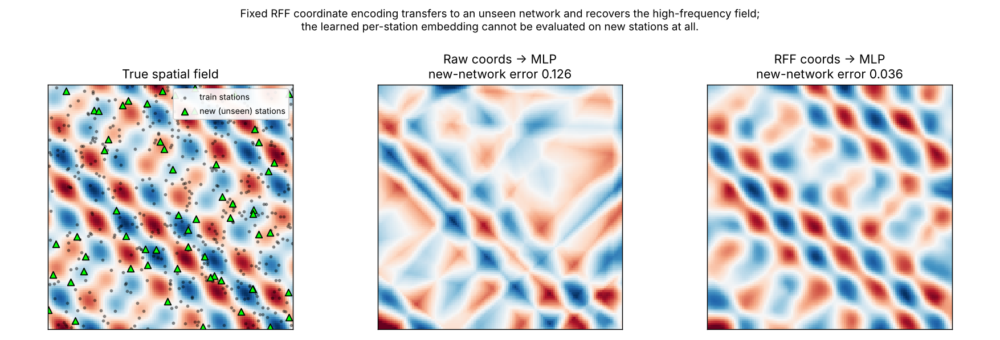

# Transferable coordinate encoding with Random Fourier Features

[](https://github.com/hager-safwat/rff-coordinate-encoding/actions/workflows/tests.yml)

[](LICENSE)

A small, tested demonstration of one idea: encoding a spatial node (a sensor,
a station, a point in a network) by a **fixed, parameter-free Random Fourier
Feature (RFF) map of its coordinates**, instead of a **learned per-node
embedding table**.

The difference decides whether a trained model can be reused on a network it
has never seen.



## The idea

Many spatial models give every node its own *learned* embedding vector,
indexed by the node's identity. That welds the trained model to one exact
network: a node that did not exist at training time has no embedding, so the
model has nothing to say about it.

An RFF coordinate map removes that limitation. It encodes a node by *where it
is*, not *which node it is*:

```
phi(x) = cos(x @ W + b),    W ~ N(0, sigma^2),  b ~ U[0, 2*pi),  drawn once and then frozen
```

Because `phi` is a fixed function of the coordinates, identical coordinates
always map to identical features, in any network. The same trained weights
then run unchanged on a network of different size and geometry. Drawing `W`
from a Gaussian also lifts the low-dimensional coordinates into a form a small
MLP can fit at high frequency, which raw coordinates alone cannot (the
"spectral bias" problem).

In the code, `W` and `b` are stored with `register_buffer`: they are saved in
the model's checkpoint but are not trainable parameters, so the optimiser
never updates them. The demo uses `D = 256` features and `sigma = 8`. (There
is no explicit `2*pi` inside the cosine: `cos(2*pi * x @ W' + b)` with
`W' ~ N(0, s^2)` is the same map with `sigma = 2*pi*s`.)

## What the demo shows

A synthetic high-frequency field is sampled at random station positions (with
noise). A model is trained on one **training network** of 500 stations and
then, with no changes and no retraining, evaluated on a **separate network of
60 new station positions**. Three encoders share the same prediction head (a
3-layer MLP, full-batch Adam, 5000 epochs), so the only thing that varies is
how a station is encoded:

| Encoder | Fit on training network | Transfer to a new network |
|---|---|---|
| Learned per-station embedding | 0.0026 | **cannot transfer** (no rows for unseen stations) |
| Raw coordinates into MLP | 0.0873 | 0.1257 |
| **RFF coordinates into MLP** | **0.0030** | **0.0363** |

Error is mean-squared error against the clean field; lower is better. Numbers
come from one run with the fixed seed (`seed = 0`, PyTorch 2.15, CPU); the
last digits can differ slightly across PyTorch versions and hardware.

Two things to read off the table:

1. The **learned embedding** fits its own network but structurally *cannot*
   be evaluated on new stations. That is the exact limitation the coordinate
   map removes.
2. Among the encodings that *can* transfer, the **raw-coordinate MLP
   underfits even the training field** (spectral bias), while the **RFF map
   fits it and transfers** to the new network with about 3.5 times lower error.

## Run it

```bash
git clone https://github.com/hager-safwat/rff-coordinate-encoding.git
cd rff-coordinate-encoding
pip install -e ".[demo]"
python rff_encoding_demo.py
```

It runs on CPU in about a minute and regenerates `figure.png` and the results
table. For a quick check: `python rff_encoding_demo.py --epochs 50 --no-figure`.

## Use the encoder in your own model

```python
import torch
from rff_encoding import RFFEncoder, Model

encoder = RFFEncoder(out_dim=256, sigma=8.0)     # frozen, nothing to train
model = Model(encoder, in_dim=256)

coords = torch.rand(60, 2)                        # any number of stations
prediction = model(coords)                        # shape (60,)
```

## Tests

```bash
pip install -e ".[dev]"
pytest -v
```

The tests check the properties the text above claims, not only that the code
runs:

| Test | What it verifies |
|---|---|
| `test_rff_has_no_trainable_parameters_but_is_saved` | `W` and `b` are buffers: in the checkpoint, not in the optimiser |
| `test_rff_buffers_unchanged_by_training` | training updates the MLP head but never `W` or `b` |
| `test_rff_encoding_depends_only_on_coordinates` | a station gets the same features in any network |
| `test_rff_approximates_gaussian_kernel` | scaled features reproduce `exp(-sigma^2 ‖x-y‖^2 / 2)` (Bochner's theorem) |
| `test_learned_embedding_cannot_encode_unseen_station` | the learned table fails on an unseen id |
| `test_rff_model_runs_unchanged_on_networks_of_any_size` | same weights on networks of 1, 60 and 500 stations |
| plus data, training and smoke tests | reproducibility, noise level, loss decrease, end-to-end demo |

Every push and pull request runs linting (`ruff`) and the test suite on
Python 3.10 and 3.12 with GitHub Actions.

## Repository structure

```
rff_encoding/
    data.py          synthetic field and station networks
    encoders.py      RFFEncoder, RawEncoder, LearnedEmbeddingEncoder
    model.py         shared MLP head, training loop, MSE
rff_encoding_demo.py experiment, results table and figure
tests/               pytest suite
pyproject.toml       packaging and tool configuration
```

## Scope

This is a **mechanism demo on fully synthetic data**. It isolates *why* a
fixed coordinate encoding transfers where a learned table cannot. It is not a
benchmark and makes no scientific claim.

Transferring cleanly (running unchanged on a new network) is a *different and
weaker* property than fully generalising (reaching the same accuracy on a new
domain). This demo illustrates the first, not the second.

## Origin

The idea comes from my master's research internship at ISTerre (Université
Grenoble Alpes, 2026). There I built a factorised space-time attention model
to detect slow slip events in multi-station GNSS displacement time series,
starting from AGCRN, and replaced its learned per-station embeddings with a
frozen RFF encoding of station coordinates so that one trained model could run
on networks it never saw (Chile, Cascadia, Japan). That code and data belong
to the lab and are not public. This repository reimplements only the
coordinate-encoding mechanism, from scratch, on toy data.

## References

- A. Rahimi and B. Recht, *Random Features for Large-Scale Kernel Machines*,
  NeurIPS 2007.
- M. Tancik et al., *Fourier Features Let Networks Learn High Frequency
  Functions in Low Dimensional Domains*, NeurIPS 2020.

## Citation

If you use this code, please cite it with the metadata in
[`CITATION.cff`](CITATION.cff) (GitHub shows a "Cite this repository" button).

## License

MIT, see [LICENSE](LICENSE).
